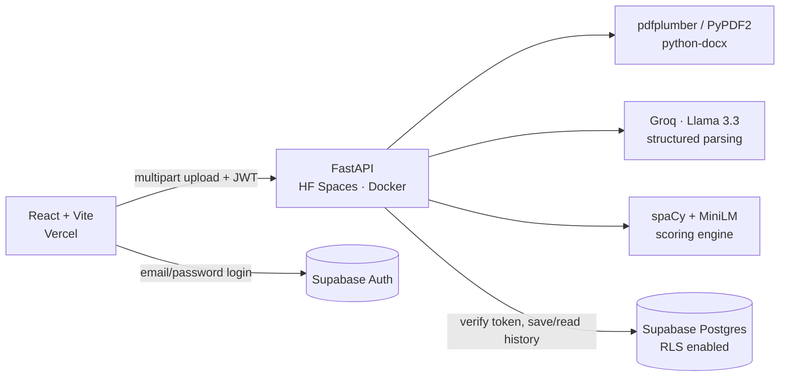

# ATS Resume Analyzer

Score a resume against a job description the way an Applicant Tracking System would, and get specific, prioritised fixes.

**Live demo:** _coming soon_ · **API docs:** _coming soon_


## What it does

Upload a PDF/DOCX resume and paste a job description. The analyzer returns:

- **An ATS score (0–100)** made of four weighted components
- **Missing keywords**: required vs. nice-to-have skills from the JD that the resume lacks
- **Requirement coverage**: each JD requirement paired with the closest line in the resume, found with BERT sentence embeddings
- **Prioritised suggestions**: missing skills, unquantified bullets, weak phrases ("responsible for"), missing sections or contact info
- **History** (optional login): past analyses saved per user

## How the score works

| Component | Weight | How it's computed |
|---|---|---|
| Keywords | 35% | Hard skills in the JD vs. the resume. Required skills count double. Matching handles aliases (`k8s` → Kubernetes, `ReactJS` → React) via a curated skill vocabulary + spaCy `PhraseMatcher`, then fuzzy matching (rapidfuzz) for variants like "RESTful APIs". |
| Semantic | 30% | Each JD requirement and each resume line is embedded with **all-MiniLM-L6-v2** (a distilled BERT sentence-transformer). For every requirement, the best cosine similarity across resume lines is taken, then rescaled from the model's practical range (0.15–0.70) to 0–1. |
| Content | 20% | Share of bullets starting with strong action verbs, number of quantified bullets (%, $, 10k…), penalty for weak phrases. |
| Formatting | 15% | Email + phone, LinkedIn/GitHub, standard section headings (Experience, Education, Skills, Projects), word count in the 350–1100 range. |

If a JD contains no recognisable hard skills, the keyword component is dropped and its weight is redistributed proportionally, so the score stays on a 0–100 scale.

**LLM parsing with a local fallback.** When a Groq API key is set, Llama 3.3 70B extracts structured data (required vs. preferred skills, responsibilities, job title) from both documents in parallel, using JSON mode with one retry. If Groq is down or rate-limited, every step falls back to local spaCy/regex extraction, so an LLM outage never breaks an analysis. The response says which parser was used.

## Architecture



**Design decisions**

- **Models load once at startup** (FastAPI lifespan), not per request. Scoring runs in a thread pool so CPU-bound embedding work never blocks the event loop.
- **Files are validated by magic bytes**, not just extension, so a renamed `.exe` → `.pdf` is rejected. Uploads are read with a size cap so oversized files are never fully buffered.
- **Auth tokens are verified by Supabase itself** (`/auth/v1/user`). This works with both legacy HS256 and newer asymmetric signing keys, so the backend never handles the JWT secret.
- **The secret key stays server-side.** The browser only holds the publishable key, and row-level security stops it from reading other users' rows.
- **Errors are typed.** Validation/parsing errors carry a user-safe message (422). Anything unexpected is logged and returned as a generic 500, so internals never leak.
- **Deployed on Hugging Face Spaces (Docker)**: torch + MiniLM need ~1 GB of RAM, which exceeds most free PaaS tiers. CPU-only torch and model weights baked into the image keep cold starts fast.

## Tech stack

**Backend:** FastAPI, Pydantic v2, spaCy, sentence-transformers (MiniLM), rapidfuzz, pdfplumber, python-docx, Groq, httpx
**Frontend:** React 19, Vite, Tailwind CSS v4, supabase-js
**Infra:** Docker, Hugging Face Spaces, Vercel, Supabase (Auth + Postgres)

## Run locally

Requires Python 3.11 and Node 20+.

```bash
# Backend
pip install torch --index-url https://download.pytorch.org/whl/cpu
pip install -r requirements-dev.txt
python -m spacy download en_core_web_sm
cp .env.example .env              # all keys optional for local dev
uvicorn backend.main:app --reload # http://localhost:8000/docs

# Frontend (new terminal)
cd frontend
npm install
cp .env.example .env              # optional: Supabase keys enable login/history
npm run dev                       # http://localhost:5173
```

Without a Groq key the analyzer uses local parsing. Without Supabase, login and history are hidden.

**Database (optional):** create a Supabase project and run [`backend/database/schema.sql`](backend/database/schema.sql) in the SQL editor.

**Docker:**

```bash
docker build -t ats-backend .
docker run -p 7860:7860 --env-file .env ats-backend
```

## Tests

```bash
pytest     # 46 tests, ~2 s
```

Tests never load the real models: a blank spaCy tokenizer and a deterministic bag-of-words embedder exercise the same scoring code in milliseconds. API tests run through FastAPI's `TestClient` without triggering the lifespan, so responses are still validated against the Pydantic response models. That catches any drift between scorer output and the API schema. Groq and Supabase are mocked, including the failure paths.

## API

| Method | Path | Auth | Description |
|---|---|---|---|
| `POST` | `/api/v1/analyze-resume` | optional | `multipart/form-data`: `file` (PDF/DOCX ≤ 5 MB), `job_description` (50–20,000 chars). Saved to history if authenticated. |
| `GET` | `/api/v1/history` | required | Last 50 analyses for the user |
| `DELETE` | `/api/v1/history/{id}` | required | Delete one of the user's analyses |
| `GET` | `/api/v1/health` | — | Model / Groq / database status |

## Project structure

```
backend/
  api/routes.py           HTTP endpoints, validation, LLM fallback orchestration
  core/                   config (weights, limits), Supabase token verification
  services/scorer.py      scoring engine (keywords, semantic, content, formatting)
  services/skills.py      curated skill vocabulary + aliases, action verbs
  services/groq_parser.py LLM structured extraction (JSON mode + retry)
  services/resume_parser.py PDF/DOCX text extraction with fallback
  database/               Supabase REST client, SQL schema
frontend/src/
  App.jsx                 views: analyze / results / history
  components/             upload form, score summary, details, history, auth
tests/                    pytest suite (scorer, parsers, API)
deploy/                   Hugging Face Space deploy script
Dockerfile
```
